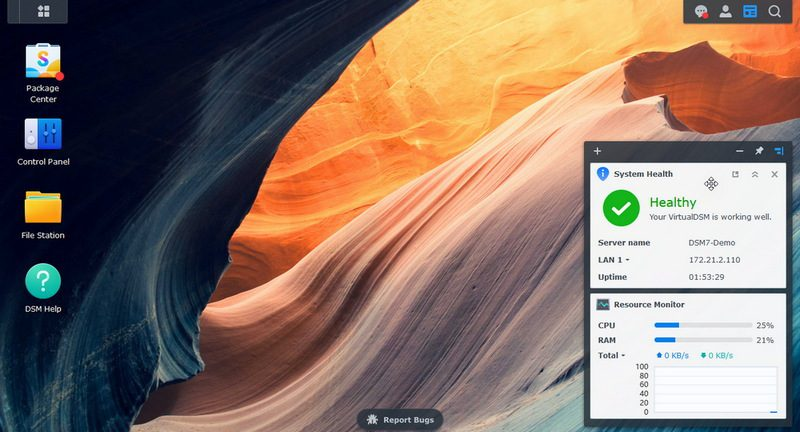

<h1 align="center">Virtual DSM<br />
<div align="center">
<a href="https://github.com/Ben8368/virtual-dsm"></a>
</div>
<div align="center">

[![Build]][build_url]
[![Package]][pkg_url]

</div></h1>

Virtual DSM in a Docker container.

## Origin and independent maintenance

This project originated from [vdsm/virtual-dsm](https://github.com/vdsm/virtual-dsm)
at commit [`88c2d4673aa428c9dc9c9ae90eaf63d0e8e2335c`](https://github.com/vdsm/virtual-dsm/commit/88c2d4673aa428c9dc9c9ae90eaf63d0e8e2335c)
(`build: Update QEMU base image to v7.50 (#1404)`).

The standalone Git history starts with an import of that exact upstream
source snapshot, followed by this maintainer's development commits. Earlier
upstream commits are available in the original repository. Importing the
snapshot does not claim authorship of the inherited code.

It is now maintained independently by [Ben8368](https://github.com/Ben8368),
with its own development direction, issue tracking and releases. Upstream
changes are not automatically synchronized; any future adoption is reviewed
individually. Credit remains with the original authors and contributors, and
the inherited [MIT license](license.md) is preserved.

Use this repository's source and images for its ARM64 support and other changes.
The original project's images do not include this repository's additions.

For local builds and Surveillance Station troubleshooting, see
[package installation](docs/package-installation.md).
For automated checks, image publishing and dependency updates, see [CI setup](docs/ci.md).
For the JavaScript/TypeScript maintenance assessment, see [web frontend](docs/web-frontend.md).
AI collaborators start at [AGENTS.md](AGENTS.md); current status is [CONTEXT.md](CONTEXT.md).
Contribution, attribution trailers and the CI 6/6 traffic light are in
[CONTRIBUTING.md](CONTRIBUTING.md).

The image targets both `linux/amd64` and `linux/arm64` container hosts.
`DSM_PLATFORM=virtualdsm` remains the stable default x86 VirtualDSM guest;
on an ARM64 host that guest uses much slower QEMU TCG.

`DSM_PLATFORM=rtd1619b` adds **experimental DS124 / rtd1619b ARM64 guest support**.
Automatic preparation from the exact official DS124 DSM 7.2.2-72806 PAT is
supported. Mutable runtime disks are preserved, and the official local setup
and single-disk Basic/Btrfs path have demonstrated persistent configuration and
data through two clean restart cycles. New seeds stage the PAT's bundled packages
and install Storage Manager through the normal package CLI. Existing roots need manual installation
from the same PAT; this is a DSM-compatible virtual layout with partially unused
capacity. ARM support remains experimental; production stability and lifecycle
evidence is recorded in the Phase 3 acceptance notes below. An x86_64 host uses slow TCG with
`max,lpa2=off`; an ARM64 host can select KVM only after a successful host/guest
compatibility probe. ARM64 KVM runtime still needs hardware validation.
See [platform configuration and automatic DS124 preparation](docs/platforms.md)
and [Phase 3 persistence evidence](research/arm64/production-phase3.md).

## Features ✨

- Runs Virtual DSM inside a Docker container
- Automatic download of the installation files
- Web-based access to the DSM desktop
- Near-native performance with KVM acceleration
- Customizable CPU, memory, and storage allocation
- Supports multiple disks and physical disk passthrough
- Dynamic memory allocation with memory ballooning
- Supports NAT, user-mode, macvlan, and macvtap networking

## Usage  🐳

Published images use `ghcr.io/ben8368/virtual-dsm:latest`. The first image must
be published with this repository's `Publish image` workflow before the
registry-based examples below can be used. Until then, build from source with
[compose.local.yml](compose.local.yml), as described in [local builds](docs/package-installation.md#local-builds).

##### Docker Compose:

```yaml
services:
  dsm:
    container_name: dsm
    image: ghcr.io/ben8368/virtual-dsm:latest
    environment:
      DISK_SIZE: "256G"
    devices:
      - /dev/kvm
      - /dev/net/tun
    cap_add:
      - NET_ADMIN
    ports:
      - 5000:5000
    volumes:
      - ./dsm:/storage
    restart: always
    stop_grace_period: 2m
```

##### Docker CLI:

```bash
docker run -it --rm --name dsm -e "DISK_SIZE=256G" -p 5000:5000 --device=/dev/kvm --device=/dev/net/tun --cap-add NET_ADMIN -v "${PWD:-.}/dsm:/storage" --stop-timeout 120 ghcr.io/ben8368/virtual-dsm:latest
```

##### Kubernetes:

```shell
kubectl apply -f https://raw.githubusercontent.com/Ben8368/virtual-dsm/refs/heads/master/kubernetes.yml
```

##### GitHub Codespaces:

[](https://codespaces.new/Ben8368/virtual-dsm)

## Requirements ⚙️

- Docker or Podman on a Linux host with KVM support.
- Docker Desktop or Podman (Desktop) on Windows 11 with nested virtualization enabled.
- At least 1 GB of available RAM.
- At least 16 GB of free disk space.

> [!NOTE]
> Docker Desktop on Linux, macOS, and Windows 10 does not currently provide KVM access to containers and is therefore not supported.

## FAQ 💬

### How do I use it?

  Very simple! These are the steps:
  
  - Start the container and connect to [port 5000](http://127.0.0.1:5000/) using your web browser.

  - Wait until DSM finishes its installation
 
  - Choose a username and password, and you will be taken to the desktop.
  
  Enjoy your brand new NAS, and don't forget to star this repo!

### How do I change the storage location?

  To change the storage location, include the following bind mount in your compose file:

  ```yaml
  volumes:
    - ./dsm:/storage
  ```

  Replace the example path `./dsm` with the desired storage folder or named volume.
 
### How do I change the size of the disk?

  To expand the default size of 256 GB, locate the `DISK_SIZE` setting in your compose file and modify it to your preferred capacity:

  ```yaml
  environment:
    DISK_SIZE: "512G"
  ```
  
> [!TIP]
> This can also be used to resize an existing disk to a larger capacity without any data loss.

### How do I add multiple disks?

  To create additional disks, modify your compose file like this:
  
  ```yaml
  environment:
    DISK2_SIZE: "500G"
    DISK3_SIZE: "750G"
  volumes:
    - ./example2:/storage2
    - ./example3:/storage3
  ```

### How do I pass through a disk?

   You can pass through disk devices or partitions directly by adding them to your compose file in this way:

  ```yaml
  devices:
    - /dev/sdb:/disk1
    - /dev/sdc1:/disk2
  ```

  Make sure it is totally empty (without any filesystem), otherwise DSM may not format it as a volume.

### How do I change the amount of CPU or RAM?

  By default, Virtual DSM will be allowed to use 2 CPU cores and 2 GB of RAM.

  If you want to adjust this, you can specify the desired amount using the following environment variables:

  ```yaml
  environment:
    RAM_SIZE: "4G"
    CPU_CORES: "4"
  ```

### How do I assign an individual IP address to the container?

  By default, the container uses bridge networking, which shares the IP address with the host. 

  If you want to assign an individual IP address to the container, you can create a macvlan network as follows:

  ```bash
  docker network create -d macvlan \
      --subnet=192.168.0.0/24 \
      --gateway=192.168.0.1 \
      --ip-range=192.168.0.100/28 \
      -o parent=eth0 vdsm
  ```
  
  Be sure to modify these values to match your local subnet. 

  Once you have created the network, change your compose file to look as follows:

  ```yaml
  services:
    dsm:
      container_name: dsm
      ..<snip>..
      networks:
        vdsm:
          ipv4_address: 192.168.0.100

  networks:
    vdsm:
      external: true
  ```
 
  An added benefit of this approach is that you won't have to perform any port mapping anymore, since all ports will be exposed by default.

> [!IMPORTANT]
> This IP address won't be accessible from the Docker host due to the design of macvlan, which doesn't permit communication between the two. If this is a concern, you need to create a [second macvlan](https://blog.oddbit.com/post/2018-03-12-using-docker-macvlan-networks/#host-access) as a workaround.

### How can DSM acquire an IP address from my router?

  After configuring the container for [macvlan](#how-do-i-assign-an-individual-ip-address-to-the-container), it is possible for DSM to become part of your home network by requesting an IP from your router, just like your other devices.

  To enable this mode, in which the container and DSM will have separate IP addresses, add the following lines to your compose file:

  ```yaml
  environment:
    DHCP: "Y"
  devices:
    - /dev/vhost-net
  device_cgroup_rules:
    - 'c *:* rwm'
  ```

### How do I enable GPU acceleration?

  To enable GPU acceleration using an Intel or AMD GPU, add the following lines to your compose file:

  ```yaml
  environment:
    GPU: "Y"
  devices:
    - /dev/dri
  ```

  For NVIDIA GPUs, the [NVIDIA Container Toolkit](https://docs.nvidia.com/datacenter/cloud-native/container-toolkit/latest/install-guide.html) must be installed on the host and the GPU must be exposed to the container:

  ```yaml
  environment:
    GPU: "Y"
    NVIDIA_DRIVER_CAPABILITIES: "all"

  deploy:
    resources:
      reservations:
        devices:
          - driver: nvidia
            count: all
            capabilities:
              - gpu
  ```

  GPU acceleration can be used to enable the facial recognition function in Synology Photos, but currently does not provide hardware transcoding for video yet.

### How do I enable dynamic memory allocation?

  By default, the DSM is allocated the full amount of RAM configured via `RAM_SIZE` for its entire lifetime.

  However, you can enable [memory ballooning](https://github.com/qemus/qemu/blob/master/docs/ballooning.md) if you want the container to dynamically reclaim unused guest RAM based on host memory pressure.

### How do I install a specific version of vDSM?

  By default, version 7.2 will be installed, but if you prefer an older version, you can add the download URL of the `.pat` file to your compose file as follows:

  ```yaml
  environment:
    URL: "https://global.synologydownload.com/download/DSM/release/7.0.1/42218/DSM_VirtualDSM_42218.pat"
  ```

  With this method, it is even possible to switch back and forth between versions while keeping your file data intact.

  Alternatively, you can also skip the download and use a local file instead, by binding it in your compose file in this way:
  
  ```yaml
  volumes:
    - ./DSM_VirtualDSM_42218.pat:/boot.pat
  ```

  Replace the example path `./DSM_VirtualDSM_42218.pat` with the filename of your desired `.pat` file. The value of `URL` will be ignored in this case.

### Are these all available options?

  No. For a complete overview of all supported settings, see the [environment variables](docs/environment.md) page.

### How do I verify that KVM is available?

  First, make sure your platform and container runtime meet the [requirements](#requirements-️) listed above.

  On a Linux host, install `cpu-checker` and run:

  ```bash
  sudo apt install cpu-checker
  sudo kvm-ok
  ```

  A working configuration should report:

  ```text
  KVM acceleration can be used
  ```

  You can also verify that the KVM device exists:

  ```bash
  ls -l /dev/kvm
  ```

  If KVM is unavailable, check whether:

  - Hardware virtualization (`Intel VT-x` or `AMD-V`) is enabled in your BIOS or UEFI.
  - Nested virtualization is enabled when the host itself is a virtual machine.
  - Your VPS or cloud provider supports nested virtualization.

  If `kvm-ok` succeeds but the container still reports that KVM is unavailable, you can temporarily add `privileged: true` to your Compose file to rule out a permission or device-access issue.

### What are the differences compared to the standard DSM?

  There are only two minor differences: the Virtual Machine Manager package is not available, and Surveillance Station will not include any free licenses.

### Is this project legal?

  Yes, this project contains only open-source code and does not distribute any material owned by Synology. Neither does it try to circumvent any copyright protection measures.
  
  However, by installing Synology's Virtual DSM, you must accept their end-user license agreement, which does not permit installation on non-Synology hardware. So only run this container on an official Synology NAS, as any other use will be a violation of their terms and conditions.

## Disclaimer ⚖️

*Only run this container on Synology hardware, any other use is not permitted by their EULA. The product names, logos, brands, and other trademarks referred to within this project are the property of their respective trademark holders. This project is not affiliated, sponsored, or endorsed by Synology, Inc.*

[build_url]: https://github.com/Ben8368/virtual-dsm/actions/workflows/test.yml
[pkg_url]: https://github.com/Ben8368/virtual-dsm/pkgs/container/virtual-dsm

[Build]: https://github.com/Ben8368/virtual-dsm/actions/workflows/test.yml/badge.svg
[Package]: https://img.shields.io/badge/GHCR-virtual--dsm-066da5?logo=github
